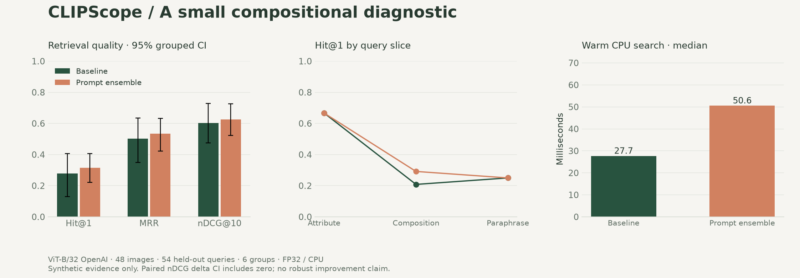

# CLIPScope

**A deployable laboratory for CLIP retrieval, controlled ablations, and failure analysis.**

[中文](README.md) · [Research notes](docs/RESEARCH.md) · [Measured results](docs/RESULTS.md) · [Validation status](docs/VALIDATION.md)

CLIPScope combines text-to-image, image-to-image and weighted image/text retrieval with an auditable evaluation pipeline. It is an engineering and experimental study of existing pretrained encoders, not a new architecture or a state-of-the-art claim.



## Run locally

Python 3.13 is recommended. The first model run downloads public weights. No paid cloud service is required.

```bash
python3 -m venv .venv
source .venv/bin/activate
pip install -e '.[model,dev]'
clipscope demo-data
clipscope suite
clipscope serve
```

Open <http://127.0.0.1:8000>. Interactive API documentation: <http://127.0.0.1:8000/docs>.

`auto` chooses CUDA, then MPS, then CPU according to availability. Docker on macOS runs a Linux CPU workload, not MPS. For a search-only setup, replace `suite` with `index`.

## What is implemented

- OpenCLIP encoders with explicit activation configuration, float32 inference, normalized features and weight-content fingerprints.
- Atomic SQLite index snapshots, content deduplication, safe local paths and exact cosine retrieval.
- Text, reference-image and weighted multimodal queries; prompt ensembles; optional MMR diversity reranking.
- Multi-positive relevance, Hit@K, Recall@10, MRR, mAP@10 and nDCG@10; grouped bootstrap intervals and paired comparisons.
- JSON/Markdown reports with complete rankings, slices, model/data/query hashes, actual package versions and scoped latency.
- Responsive web interface, read-only serving API, optional bearer authentication, bounded uploads, Docker configuration and CI.

## Experimental discipline

The original 48-image diagnostic varies color, shape, position and count. Its 108 English queries are split into dev/test at the color-shape group level, with six groups and 54 queries per split; both use the same fixed gallery. This is deliberately a small synthetic compositional stress test, not a natural-image benchmark. Correlated paraphrases are resampled together. A fixed three-template ensemble is compared against raw queries without test-set template tuning.

Image-to-text currently uses one caption per image. It does not implement the standard five-caption COCO evaluation protocol. Its measured latency includes ranking only, whereas text-to-image includes warm text encoding and ranking.

```bash
clipscope compare experiments/results/b32-openai-test-baseline.json \
  experiments/results/b32-openai-test-ensemble.json

# Optional checkpoint comparison; requires a separate weight download
clipscope suite --model b32-laion --index data/laion.sqlite
```

Additional checkpoints are supported but are not measured until actually run. Results and limitations are tracked in [RESULTS](docs/RESULTS.md). To extend to licensed natural images, use the [COCO-format importer](scripts/import_coco.py) and [data contract](docs/DATASETS.md).

## Testing and deployment

```bash
pip install -e '.[dev]'
pytest -q  # No pretrained models required

docker compose build
docker compose run --rm clipscope clipscope demo-data
docker compose run --rm clipscope clipscope index --device cpu
docker compose up -d
```

The index and model cache persist in named volumes. The default port binds only to localhost. Add HTTPS, authentication and upstream rate limits before exposing the service publicly. See [deployment](docs/DEPLOYMENT.md) and [actual validation](docs/VALIDATION.md).

The macOS ARM64 lock file records the observed environment; dependency ranges in `pyproject.toml` are portable but not a universal lock. Reports record actual versions and content hashes. Tests use an explicit analytical fixture, never presented as CLIP performance.

## Research references and license

[CLIP](https://proceedings.mlr.press/v139/radford21a.html) · [OpenCLIP](https://github.com/mlfoundations/open_clip) · [PyTorch MPS](https://docs.pytorch.org/docs/stable/notes/mps.html)

Code: MIT. Original generated diagnostic images: CC0-1.0. External weights and datasets retain their own terms. No model weights or third-party images are redistributed in this repository.
