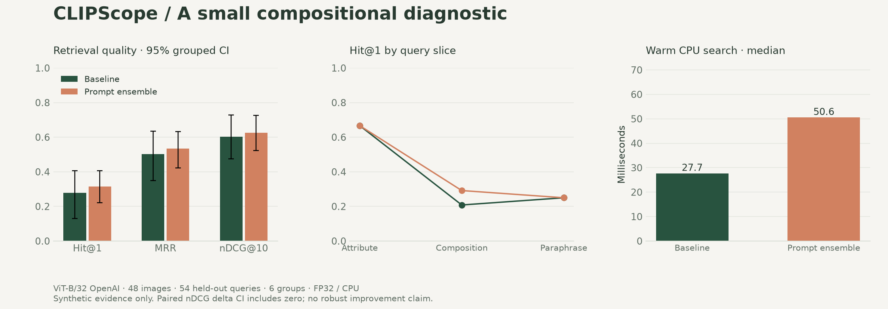
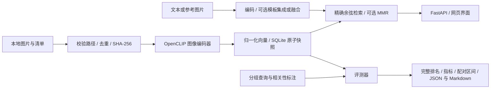

# CLIPScope

**Search beyond words. Measure what matters.**

一个可部署、可审计的 CLIP 多模态检索研究工作台。包含文本搜图、以图搜图、混合查询、提示词消融和失败案例分析。面向希望把模型理解转化为可验证工程证据的研究者与开发者。

[English](README.en.md) · [研究笔记](docs/RESEARCH.md) · [实验协议](experiments/protocol.json) · [部署](docs/DEPLOYMENT.md) · [数据格式](docs/DATASETS.md) · [实际验证记录](docs/VALIDATION.md)

> 本项目是基于已有预训练模型的系统工程与实验研究，不宣称提出新 CLIP 架构或取得 SOTA。合成图实验不能替代真实照片基准。只有 `experiments/results/` 中保存的运行才代表已经测得的结果。



## 为什么不止是一个搜索 Demo

| 能力 | 实现与研究意义 |
|---|---|
| 可追溯推理 | 记录权重 SHA-256、模型、激活函数、预处理、设备和依赖版本；拒绝混用不同模型的索引 |
| 多模态查询 | 归一化图文向量融合、纯文本检索、参考图检索；独立图片上传，不污染图库 |
| 有控制的消融 | 原始查询 vs 三模板集成，固定图库、检查点与排序；输出配对差值区间 |
| 严谨评测 | 多正确答案、Hit@K / Recall@K / MRR / mAP / nDCG、分组 bootstrap、逐查询完整排名 |
| 失败分析 | 属性、组合关系、改写切片；界面展示最差查询，方便检查“语义相似但关系错误” |
| 可部署工程 | FastAPI、单进程模型复用、原子 SQLite 索引、请求体限制、可选 token、Docker、CI |

## 快速开始

建议使用 Python 3.13；Apple Silicon 原生 Python 可自动选择可用的 MPS，否则回退 CPU。首次运行会下载公开模型权重，需要网络和数 GB 可用空间。安装在虚拟环境中，不需要云 GPU。

```bash
python3 -m venv .venv
source .venv/bin/activate
python -m pip install -e '.[model,dev]'
clipscope demo-data
clipscope suite
clipscope serve
```

打开 <http://127.0.0.1:8000>。API 文档在 <http://127.0.0.1:8000/docs>。`suite` 会生成索引，并运行原始查询、提示词集成和图到文检索；首次 CPU 运行可能需要数分钟。

只需启动搜索、暂不评测时，用 `clipscope index` 替换 `clipscope suite`。无需下载模型即可运行工程测试：`pip install -e '.[dev]' && pytest -q`。

```bash
# 显式选择设备；若 mps 不可用请使用 cpu
clipscope index --device cpu

# 比较同一模型的两个运行，输出 B − A 和配对 95% 区间
clipscope compare experiments/results/b32-openai-test-baseline.json \
  experiments/results/b32-openai-test-ensemble.json

# 可选第二检查点：另建索引，避免覆盖正在提供服务的索引
clipscope suite --model b32-laion --index data/laion.sqlite
```

第二检查点需要额外下载，未运行前不能声称完成了模型间对比。默认预训练 CLIP 以英文输入为主；中文 UI 不代表中文检索质量已验证。

## 实验设计

随项目生成的原创图集包含 **48 张图、108 条查询**：4 种颜色 × 3 种形状 × 2 个位置 × 2 种数量。开发/测试按颜色—形状组合划分，各有 6 个组、54 条查询，图库固定为全部 48 张图。对应图片仍在图库内，这是检索任务设定，并非模型训练。

- 单一属性查询存在多个正确答案；严格组合与改写查询只接受特定的颜色、形状、位置、数量组合。
- 置信区间以颜色—形状组为重采样单位，避免将相关改写误当作独立证据。
- 模板在首次评测前固定；不根据测试集结果调优。仅 6 个测试组的区间仍不稳定。
- 图到文目前采用每图一条 caption 的图库，不能直接与标准多 caption COCO 排行榜对比。
- 热启动文本检索耗时包含文本编码与排序；图到文耗时只含缓存向量排序。两者不可直接比较为推理速度。

实际结果与解读见 [实验报告](docs/RESULTS.md)。扩展真实照片实验可使用 [COCO 格式导入脚本](scripts/import_coco.py)，无需改动评测核心。

## 架构



默认使用精确矩阵检索而非 ANN，以免近似误差干扰模型消融；图库规模上限为 20,000，矩阵驻留内存。模型权重仅在服务启动时加载一次，推理由锁序列化。它是单机作品集与研究工作台，不是已经验证的大规模生产服务。

```text
src/clipscope/   编码器、索引、评测、API、CLI、网页
tests/          无模型下载的指标、索引、数据边界与 API 测试
experiments/    固定协议与实际运行报告
scripts/        真实数据集导入
docs/           原理、数据、部署、结果、面试讨论与验证记录
```

## 部署与复现

```bash
docker compose build
docker compose run --rm clipscope clipscope demo-data
docker compose run --rm clipscope clipscope index --device cpu
docker compose up -d
```

Docker 在 Mac 上使用 Linux CPU，不使用 macOS MPS；要使用 MPS，请原生启动。详见 [部署说明](docs/DEPLOYMENT.md)。发布前请依据 [验证记录](docs/VALIDATION.md) 区分已完成的测试与尚未执行的环境验证。

`requirements-macos-arm64.lock.txt` 记录本次本地安装环境；跨平台安装默认使用 `pyproject.toml`，它允许兼容版本范围，**不是跨平台完全锁定的环境**。每份实验报告保存实际依赖版本、权重内容摘要与数据摘要。

## 用于作品集

请先读懂并亲自复现实验，再把自己能够解释的实现与结论写进简历。可重点讨论 [设计取舍与面试问题](docs/PORTFOLIO.md)：为什么不把相似度当概率、如何防止实验泄漏、为什么统计单位比查询条数更重要，以及精确索引与 ANN 的取舍。

代码使用 MIT；生成的原创合成图片为 CC0-1.0。预训练权重与外部数据遵循各自许可。参考：[CLIP 论文](https://proceedings.mlr.press/v139/radford21a.html)、[OpenCLIP](https://github.com/mlfoundations/open_clip)、[PyTorch MPS](https://docs.pytorch.org/docs/stable/notes/mps.html)。
