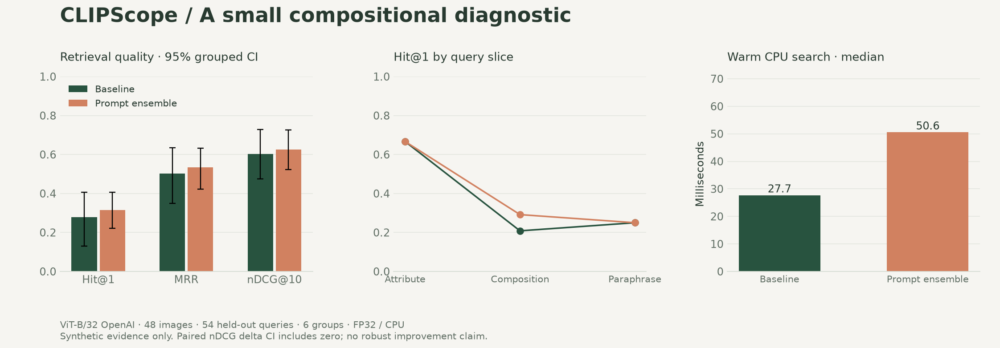

# 实测结果 / Measured results



## 范围与配置

实验时间（UTC）：2026-11-02T06:09:17.682672+00:00。模型：OpenAI ViT-B/32，QuickGELU，FP32；实际设备：**CPU**。

图库 48 张；文到图测试查询 54 条；独立重采样组 6 个。没有微调、没有使用付费云 GPU。原始与集成方法使用相同 checkpoint、图库和查询，MMR 关闭。

## 文到图检索

| 指标 | 原始查询 | 提示词集成 | 配对差值 B−A 的 95% 区间 |
|---|---:|---:|---:|
| hit@1 | 0.2778 | 0.3148 | [0.0000, 0.0741] |
| hit@5 | 0.8333 | 0.8333 | [0.0000, 0.0000] |
| recall@10 | 0.9306 | 0.9306 | [0.0000, 0.0000] |
| mrr | 0.5020 | 0.5350 | [-0.0031, 0.0732] |
| map@10 | 0.4923 | 0.5230 | [-0.0031, 0.0680] |
| ndcg@10 | 0.6017 | 0.6255 | [-0.0024, 0.0527] |

热启动文本检索 p50：原始 27.71 ms，集成 50.57 ms；p95 分别 30.83 / 55.21 ms。计时包含文本编码与精确排序，不含模型加载及图像建索引。该单次顺序运行没有量化性能方差，不能外推为并发服务吞吐。

## 证据支持什么

主指标 nDCG@10 增加 0.0238，但配对区间包含 0，**不能声称提示词集成带来稳定、可推广的提升**。Hit@1 仅增加了两条命中查询；多指标中选最好看的结果会产生选择偏差。

| 查询切片 | 查询数量 | 原始 Hit@1 | 集成 Hit@1 |
|---|---:|---:|---:|
| attribute | 6 | 0.6667 | 0.6667 |
| composition | 24 | 0.2083 | 0.2917 |
| paraphrase | 24 | 0.2500 | 0.2500 |

在这个样本上，属性查询命中率高于严格组合查询；这支持继续调查数量与位置关系，但不能隔离域偏移、查询措辞等混杂因素。属性切片只有 6 条查询，不能仅凭切片点估计声称普遍规律。

## 具体失败案例

- 查询 `two green squares on the left side of a plain background`，第一名 `green-square-right-1`，正确图像 `green-square-left-2`。
- 查询 `a plain canvas with two green squares placed to the left`，第一名 `green-circle-left-2`，正确图像 `green-square-left-2`。
- 查询 `a plain canvas with two green squares placed to the right`，第一名 `green-square-right-1`，正确图像 `green-square-right-2`。
- 查询 `two green squares on the right side of a plain background`，第一名 `green-square-right-1`，正确图像 `green-square-right-2`。

这些案例既包含数量/位置错误，也包含形状混淆。不能将全部错误归结为单一的“空间推理缺陷”。

## 图到文检索

测试源图 24 张，caption 图库 48 条。Hit@1=0.3333，MRR=0.5754，nDCG@10=0.6809。该方向使用预计算图像与 caption 向量，因此报告中的耗时只覆盖排序，不是完整图像推理耗时。

## 复现与未完成的研究

- 原始 JSON 保存全部排名、预处理、依赖版本、权重内容摘要、核心源码摘要、数据和查询摘要。
- 参数与数据协议在首次评测前固定；测试结果未被用于模板选择。
- 尚未运行第二个 checkpoint、自然照片基准、中文检索或 MPS 实测。
- 只有 6 个测试组，bootstrap 区间不稳定；无多重比较校正，不做总体模型能力或统计显著性宣传。

```bash
clipscope demo-data
clipscope suite --device cpu
pip install -e '.[plots]'
python scripts/plot_results.py
```

源码与模型指纹：

- 核心 Python 源码 SHA-256：`552823834f4482110e859bd95ea09e82ffb91554cbef1c322498811d45f90a32`
- 权重内容 SHA-256：`a3ce3c4a2245ed2a572d2eb864a62f0a4ca62b3123b83f8a52a523c3b1dd32a4`
- 数据摘要：`49908e47d9ba7610ee21d92912df157e8d99ba8a0c8601be28418013a52f77f1`

原始结果：[baseline](../experiments/results/b32-openai-test-baseline.json) · [ensemble](../experiments/results/b32-openai-test-ensemble.json) · [paired comparison](../experiments/results/b32-openai-test-comparison.json) · [image-to-text](../experiments/results/b32-openai-test-image-to-text.json)
