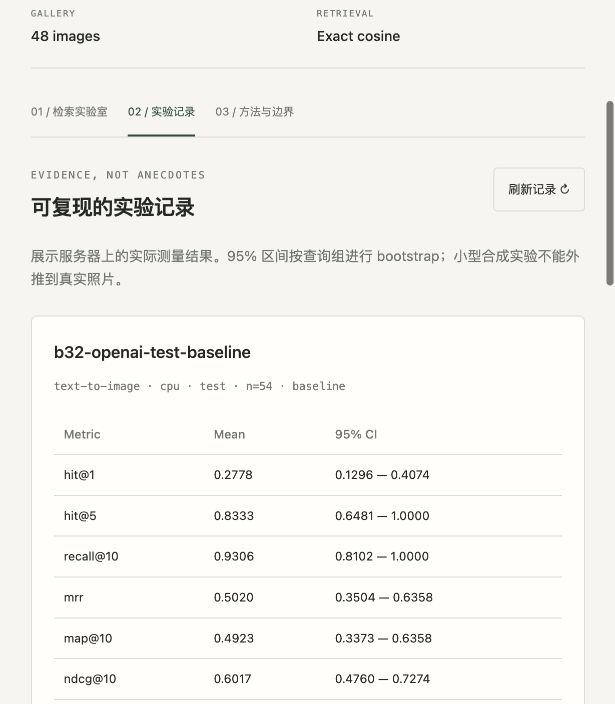

# 实际验证记录

验证日期：2026-11-02（Australia/Sydney）。本文件记录本次交付中真正执行的检查，不代表所有平台均通过。

| 项目 | 状态 | 证据与范围 |
|---|---|---|
| 隔离安装 | 已完成 | macOS ARM64，Python 3.14.7；实际版本见 lock 文件 |
| 无模型工程测试 | **15 passed** | 独立 core-venv，未安装 torch；指标、分组泄漏、索引快照、路径/重复、API、COCO 导入 |
| 完整依赖工程测试 | **15 passed** | 安装了 OpenCLIP / PyTorch 的隔离环境 |
| 真实权重推理 | 已完成 | OpenAI ViT-B/32，QuickGELU，FP32，512 维归一化向量 |
| 真实模型评测 | 已完成 | 文到图 baseline / ensemble，各 54 查询；图到文 24 源图；完整 JSON 与 Markdown |
| 真实 HTTP smoke | 已完成 | 文本、参考图片、混合查询与三个报告；参考图片自检索命中自身 |
| 网页交互 | 已完成部分 | 浏览器中检查提示词对比、实验页、失败案例展开；检查窄视口布局并保存截图 |
| JavaScript | 已完成 | `node --check src/clipscope/static/app.js` |
| Python 编译 | 已完成 | `python -m compileall -q src scripts` |
| Python wheel | 已构建 | 包含 static HTML/CSS/JS；不打包模型与运行数据 |
| Compose YAML | 已解析 | 不等价于 Docker 运行验证 |
| Docker 构建/启动 | **未执行** | 当前环境没有 Docker；CI 已配置构建和 CLI smoke |
| GitHub Actions | **未执行** | 尚未创建或推送远程仓库 |
| MPS | **未执行** | `is_built=True`，`is_available=False`；真实报告记录 CPU |
| 第二 checkpoint / 自然照片 | **未执行** | 提供模型注册项和数据导入流程，没有伪造结果 |
| 公网部署 / 负载测试 | **未执行** | 已提供部署配置，未开通云资源 |

轻量测试环境产生了一条上游 Starlette 提示：TestClient 将逐步转向 httpx2；当前 httpx 测试仍全部通过，未屏蔽警告。

早期下载曾因 DNS 失败中断，恢复网络后成功。初次模型 smoke 发现 OpenAI checkpoint 与普通 GELU 配置的警告，已在正式评测前强制 QuickGELU，并将配置纳入指纹。交付报告全部来自修正后的配置。

自动化测试使用的 `FakeEncoder` 只存在于 `tests/conftest.py`，用于可精确验证的工程测试；它没有作为产品运行模式，也没有进入任何正式实验报告。

## 复验

```bash
pip install -e '.[dev]'
pytest -q
node --check src/clipscope/static/app.js
python -m compileall -q src scripts

pip install -e '.[model]'
clipscope demo-data
clipscope suite --device cpu
clipscope serve
```

索引和模型缓存在本地，临时预览服务在交付前停止，以免持续占用内存。通过仓库 README 重新启动，或在本次工作目录中使用随交付附带的启动脚本。


